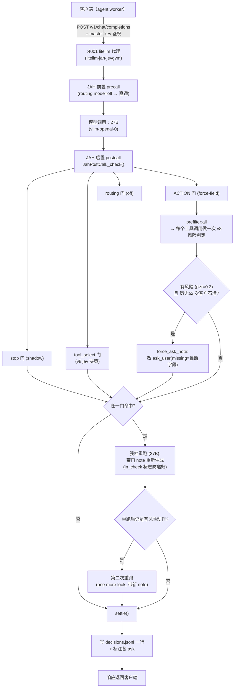

# 决策模型 GRPO 训练数据（v2，生产数据源）

> 2026-11-07。配合 11-07 上线的 `log_decision_state` 与 `training/data_v2.py` 使用。
> 规范与配方：`BENCHMARK_SPEC.md`（指标）、`TRAINING_RECIPES.md`（R6b 决策级 GRPO、
> `data.py` 的示例格式是唯一数据格式）。本文只讲生产侧数据。

## 1. 现状盘点（11-07，`~/.jah/litellm-logs/decisions.jsonl`，4509 行）

| 决策点 | 行数 | 带标签 | 带 state（11-07 后） | 说明 |
|---|---|---|---|---|
| routing | 3642 | 0（无重跑，无金标） | 11-07 起 | 只可做 soft 目标（模型自身 p），`--include-routing` 可选 |
| tool_select | 355 标签（≤11-04） | 355 | 11-07 起重新采集 | 标签 = agent 实际调用的工具（System-2 金标） |
| stop | 148 标签 | 148 | 否（保持 off） | 标签需 strong 全上下文重跑；fit 负结论已定案，不重开 |
| 错误行 | 5 | — | — | 全部在 11-05 前（旧模型/隧道瞬断） |

关键缺口：**11-07 之前所有决策行都没有 state**——只有 state + question + options 才能拼出
与服务端 byte 级一致的训练 prompt（`data.render`），旧标签行因此不可用，这是 v2 与旧日志的
分界线，不是缺陷。

## 2. 11-07 的两处改动（已部署验证）

1. **`log_decision_state: true`**（`jah-config.yaml`）：决策行（routing + 各决策点）写入
   `state` 字段——即**截断后发给决策模型的精确字符串**（`Decision.state`，含 TRUNC_NOTE）。
   探针验证：`grpo-state-check-1` 会话的 routing 与 tool_select 行均带 71 字符 state，
   格式 `TASK: … STEPS SO FAR: … [n] ACTION: … RESULT: …`。
2. **`tool_select: {mode: shadow}` 重新开启**：仅为采标签（shadow 不干预请求；fit 负结论
   仍然有效——该点禁止进 guard/trigger 模式）。代价 = 每步一次免费决策调用（~0.26 s），
   按 11-03 流量约 200 标签/天。

## 3. 构建 v2 数据集

```bash
# research/ 目录
PYTHONPATH=src uv run python -m jevharness.training.data_v2 \
    ~/.jah/litellm-logs/decisions.jsonl --out data/train_v2 [--since 2026-11-07]
```

- 输出 `train.jsonl` / `dev.jsonl`（按 session 分组切分，同一会话不跨集）+ `MANIFEST.json`
  （每条 skip 原因计数：`no_state` / `label_not_in_options` / `duplicate` / `error_row` …，
  静默丢数据会显形）。
- 规则：`label` 非空 + `fit_ok` + `state` 非空；标签必须出现在 options 里（工具改名
  bash→shell 的跨代行自动跳过）；(session, step, point) 去重，与 `jah fit` 同一口径。
- 11-07 当天实测：4509 行 → 3 条（全部来自部署后的新行），`no_state` 859、
  `point_unlabelled` 3642（routing）、`error_row` 5。

规模估计：tool_select ~200/天，**两周 ≈ 2–3k 条**（加上 routing soft 行可更多，但 routing
soft 行只建议用于消融，不进主目标）。

## 4. 训练路径（与 R6b 配方的对应）

当前部署的 4B 输出 **JSON 概率**（`/v1/systemone` 的 card 接口），而 `grpo_trl.py` 的 TRL
实现要求初始模型直接输出 **option-code token**（A/B/C…，`data.render` 格式）。因此重训是
两段式：

1. **SFT**（`scripts/train/12_sft_v1.sh`，L4/L40S preset）：在 `mix(train_v1, train_v2)` 上
   把 4B 从 JSON 概率头迁到 option-code 头（v1 的 15.7k 条为主干，v2 提供生产分布增量）。
2. **R6b 决策级 GRPO**（`60_grpo_trl.sh`，G=8，rewards `correct,format`；或 `IMPL=torch`
   的受限 softmax 实现，无需生成、单进程）：在 SFT adapter 之上，用 v2 的金标行做可验证
   奖励（argmax==gold）+ 格式奖励 +（可选）soft/qvalue 奖励。

之后回生产：新模型上线时换 `decision.model` 与 calibration（新模型重新标定；
`jah fit --decision-model <name>` 按 era 重拟合 tau；decisions 行带 model×calibrated×truncated，
era 天然可切，见 `6909f1d`）。

## 5. 注意事项

- **不要混代**：训练/评测一律按 era（model × calibrated × truncated）切分；旧 355 条
  tool_select 标签（无 state）若将来需要，只能用于统计，不能进 prompt 级训练。
- **state 截断是忠实的**：`max_state_tokens: 2800` 截尾正是服务端看到的字节，训练用截断态
  等于线上真实输入，不是近似。
- **tool_select 标签语义**：标签是 agent *实际*调用的工具（含模型可能答错的情形）——这正是
  GRPO 要的"可验证奖励"：答对=agent 真实选择。它不要求决策模型在训练前就答得对
  （11-04 一致率 13.4% 不改变数据的有效性，只说明起点低）。
- **stop 不采**：标签要付 strong 全上下文重跑的代价且 fit 已证伪，维持 off。
- **成本**：shadow 采集只消耗免费决策模型；SFT/GRPO 的 GPU 成本见 `TRAINING_RECIPES.md`
  预算表（T6b 单卡 1–8 h）。

## 6. 首次 train_v2 GRPO 实验记录

2026-11-11 在已发布的 `AgentDecision-4B` adapter 上，用 `data/train_v2` 做了 1 epoch
决策级 GRPO（`--impl torch`，reward=`correct`）。dev accuracy 10.81% → 35.14%，但
NLL/Brier/ECE 变差，且训练后段出现明显 entropy collapse。完整命令、指标、问题分析与
下一次训练建议见
[`../results/training/grpo_train_v2_2026-11-11.md`](../results/training/grpo_train_v2_2026-11-11.md)。

## 7. routing 金标与 choice:2 拟合（11-12，负结论）

新 GRPO 决策模型于 11-11 18:00 上线（同一逻辑名 `AgentDecision-4B`、同一 ssh-tunnel 端点）。
tool_select 已单独重标定（`choice:6-16: 2.508`），但 routing 头（2 选项 hard/routine）仍沿用旧
模型 `global` 温度（0.772）且无自身金标。这里生成 routing 金标并拟合专用 `choice:2`。

**金标构造**（`scripts/routing_gold_judge.py`）：取新 era（≥11-11 18:00）全部带 state 的 routing 行
（292 条），用 strong 模型（deepseek-v4.1-flash，即生产 strong 层）作 reference judge。judge 只看
state（不看结果，与决策模型输入一致），逐条判 ROUTINE/HARD。结果 **47.3% HARD / 52.7% ROUTINE**
（judge 判断均衡、无明显偏向）。金标 + state 存 `data/routing_gold_v2.jsonl`（292 行，自包含）。

**拟合**（`scripts/routing_gold_fit.py`）：反演 logged p(hard)→raw（global 0.772），
`fit_temperature` → **T 撞搜索上界 20**（坍缩到先验：median 0.756→0.511，fires@0.85 36%→0%）。

**结论（负）**：routing 头没有可用的难度信号。
- AUC(logged p(hard) vs judge) = **0.462**（SE 0.034，z=−1.13，p≈0.26）——**与 0.5 无显著差异**
  （raw AUC 0.446）。并非强反相关，信号基本≈随机。
- 对 judge 的 routing 准确率 @tau 0.85 = **49.7% < "永远发 fast" 基线 52.7%**；全 tau 最优仅 54.8%
  （+2.1pp，边际）。
- T=20 坍缩后 NLL/Brier/ECE "变好"是坍缩到先验的假象，routing 并未改善。

**处理**：**不给 routing 加 `choice:2`**（温度只能重标定单调信号；对无信息信号无意义，只会坍缩
成抛硬币）。维持当前配置（global 0.772 + tau 0.85，fires ~36%，*率*合理）。这是真实发现：GRPO 提升
了 tool_select（10.8%→35.1%）但 routing 头基本失效。若 routing 质量真正重要，有两条确定性路径：
(a) **A/B 金标**：对一批步骤实跑 fast vs strong，量实际失败率（"hard=fast 会失败"的权威定义）；
(b) **routing 回退**：routing 用 GRPO 前旧模型、tool_select 用新模型（需同时服务两个决策模型）。

注：judge 是 strong 模型的判断（代理，非 ground truth）；即便按 judge 字面，routing 也低于
always-fast 基线，故"不信任新 routing / 不为其标定"的结论成立。

## 8. A/B 金标：fast 模型真实失败率（11-12/13，含数据告警）

§7 的 judge 是代理。这里用一个**客观** A/B 金标直接回答"这步是否真的 hard"：把 fast 模型
（Qwen3.8-27B，仅给 15 个工具名、无 schema）跑在每个 routing state 上，让它预测下一个工具，
与 agent 实际执行的动作（`tool_select` 标签）对比。**fast 未能复现实际动作 = hard**。
脚本：`scripts/ab_fast_run.py`（远端 27B 上跑）+ `scripts/ab_score.py`（本地计分）。

**数据告警（重要）**：292 条新 era routing 行其实只有 **120 个唯一 (session,step) 步**（客户端重试
把同一步记多次；同一步的 `actual` 与 `tools` 一致，但 `state` 文本每次渲染不同）。`ab_out.jsonl`
（fast 预测）以完成顺序写入、与 `ab_input.jsonl` 不按行对齐，故 86 个重复步的两条预测无法绑回
具体某次重试，其中 42 个两步预测不一致——约 35% 唯一步的 A/B 金标有歧义。因此**下文精确数字依赖
去重/对齐方法**（`ab_score.py` 另有一处 judge 计数小 bug）。稳健结论不依赖方法。干净重建
（按步取最早 state 去重 + 重跑 fast）是后续。

**结果（干净重建，权威）**：120 个唯一步各取最早一条 canonical state 重跑 fast（1:1，无配对歧义）：
- A/B 金标 hard 率（fast 失败）= **63.3%**；judge 金标 hard 率 = **55.0%**；两者一致率仅 **53.3%**
  （A/B gold 被 fast 残血污染，"fast 失败" ≠ "这步本身难"）。
- **AUC(p_hard, A/B 金标) = 0.459**（SE 0.039，≈随机）；**AUC(p_hard, judge 金标) = 0.548**
  （SE 0.037，略高于随机）。
- 早先"78 无歧义步"的 0.646 是用多条一致预测的高估；单条干净预测下回落到随机。

**结论（最终）**：routing 头基本无有用信号（对两种 gold 的 AUC 都≈随机）；决策模型价值在
tool_select（GRPO 后 10.8%→35.1%）。维持 routing 现状（global 0.772 + tau 0.85），不为它标定；
要让 routing 更强需重训 routing 头或用旧模型。

## 9. train_v2 GRPO 实验记录（两轮）

2026-11-11 在已发布的 `AgentDecision-4B` adapter 上，用 `data/train_v2` 做了两轮
决策级 GRPO（`--impl torch`，reward=`correct`）。第一轮 1 epoch：dev accuracy
10.81% → 35.14%，但 NLL/Brier/ECE 变差，且训练后段出现明显 entropy collapse。
第二轮加了逐 checkpoint dev 评估与早停（G=16、lr=3e-6、beta=0.05）：collapse 明显缓解，
但 dev top-1 最高为 step 40 的 29.73%，低于第一轮最终点；最佳部署候选不是最终 step 80。
完整命令、指标、两轮对比与下一步建议见
[`../results/training/grpo_train_v2_2026-11-11.md`](../results/training/grpo_train_v2_2026-11-11.md)。

## 10. train_v3 重新划分 dev（11-14）

旧 `data/train_v3/dev.jsonl` 只有 81 条 / 14 个 session：其中一个 alt session 占 38 条，
且 dev 几乎没有 main harness 的 shell/edit 主体；另外有 16 条来自 v2 train。用它做 v2/v3
模型对比会同时受到分布偏移和泄漏影响。

新的 session-level 划分在 `data/train_v3_clean/`，原始 `data/train_v3` 保持不变：

| split | rows | sessions | 用途 |
|---|---:|---:|---|
| `train.jsonl` | 2189 | 105 | 训练（975 条 main session 和 49ff 都留在 train） |
| `dev.jsonl` | 264 | 11 | **主 dev**，main harness |
| `dev_alt.jsonl` | 94 | 22 | alt harness + 稀有工具，单独报告 |
| `dev_shell.jsonl` | 12 | 1 | shell_run / browse_web 诊断，不参与主指标 |

关键规则：

- 不要把 `dev.jsonl` / `dev_alt.jsonl` / `dev_shell.jsonl` 拼成一个 aggregate；
- `dev.jsonl` 只作为模型选择主指标，alt 和 shell 分开看 per-tool accuracy / confusion；
- `shell_wait` 没有 held-out 行（7 条都在 train 的 49ff 里），这是当前数据缺口；
- 旧 v2/v3 checkpoint 都见过这些 dev 行，不能在新 dev 上直接比较，必须在
  `train_v3_clean/train.jsonl` 上重训。

重建脚本：`scripts/resplit_v3_dev.py --force`；详细说明见
`data/train_v3_clean/SPLIT.md`。评估脚本已增加 `by_tool` 与 `confusion`。

2026-11-15 已按该 split 做 P1 重训：`dev-acc` 早停在 step 55/137（未跑满 1 epoch），
最佳 top-1 为 `step-000040`；主 dev 相对 init +3.79 pp，但 NLL/Brier/ECE 都更差。
结果与对比见 [`../results/training/grpo_train_v3_2026-11-14.md`](../results/training/grpo_train_v3_2026-11-14.md) §12。

## 11. 数据积累路线（11-15，hard_v2/v3 之后）

现状基线：生产 = hard_v3 模型 + 新校准（dev 51.52%、NLL 1.63、ECE 0.075）；
tool_select 标签采集 ~300-500 条/天（shadow）；dev 264 条。

### 11.1 轨道 A：每周生产挖矿（主力）
- 命令：`mine_hard_cases --decisions data/decisions.jsonl --exclude <历次 hard_cases + 全部 dev 切片>`（服务器）；
  模型/adapter 用当前生产 adapter 打分。
- caps 向弱工具倾斜：grep / glob / compress / webfetch / write 提配额；reply 继续压低
  （已 40.5%，防 v2 式过校正）；shell 系 = 0。
- 净增 ~500 条/月（标签增速 ~300-500/天，去重 + 排除已用后）；gold = agent 实际动作
  （自动入库），抽查 10% 保证标签质量。
- 新样本：本机 `~/.jah/litellm-logs/decisions.jsonl` 定期 scp 上服务器
  `research/data/decisions.jsonl`（11-15 时 10100 行）。

### 11.2 轨道 B：扩 dev（最优先，结构性短板）
- 当前 dev 264 条太小：单工具 ±4pp ≈ ±10 条，区分度低（v2 的 read 回退就靠它才看见）。
- rolling holdout：最近 3-5 天的 session 只进 dev、不进 train（时间切分天然防泄漏，
  与 session 切分二选一或混合）。
- 逐工具切片（仿 dev_alt/dev_shell）：dev_grep / dev_compress / dev_edit / dev_web，
  各 10-30 条，用于逐工具验收。
- 目标：3 个月内 dev 264 → 800-1200，每个弱工具 ≥30 条。

### 11.3 轨道 C（低优先）
- **stop**：shadow 继续攒新 era 标签，≥30 条后重拟合 tau —— 唯一有直接省钱收益的点
  （fast 终答不再被 strong 重跑）。
- **routing**：现状 = 校准后几乎不 fire（p_hard 0.09-0.36 < tau 0.85），first-step +
  finish check 兜底。若要翻案，需要 A/B 金标连续 4 周（~150 唯一步/周，攒 600+）且
  AUC 稳定 >0.65；否则维持现状。

### 11.4 纪律
1. 去重键 = `(session, step, sha256(state)[:16])`，保留最早一条（与 data_v2 一致）。
2. 防泄漏：任何新样本入 train 前先 `--exclude` 对照 dev / dev_alt / dev_shell + 历次
   hard_cases（v2/v3 均为 0 泄漏，保持）。
3. 版本化：`train_v4` / `hard_weighted_v4` + MANIFEST 提交仓库；不覆盖旧版本。
4. session 失衡：单 session ≤5% 入 train 池（v3 头部 session 占 39%，需降采样）。
5. 验收门 = 逐工具混淆矩阵 + NLL/ECE；整体 acc 不算数（v2 教训：整体 50% 不变，
   但 reply +19pp 与 read −11pp 此消彼长）。
6. truncated 样本：本轮 build 丢了 41 条（state 超 2800 token 截断），需查占比与原因，
   决定是否提高 max_state_tokens 或单独处理。

### 11.5 节奏
- 每周：生产挖矿（轨道 A）+ 时间切分进 dev（轨道 B）。
- 每 2-4 周：合并构建 `hard_weighted_vN` → 训练（P=16、skip-zero-std、dev-acc 早停）
  → 逐工具验收 → 温度缩放 → 部署（adapter + calibration 一起，见 grpo_train_v3 记录
  §14/§15 的流程）。
- 每月：审 session 失衡与 truncated 比例；看 stop 标签是否到 30 条可拟合。

### 12. v5/v6 轮进展与部署决策（11-16）

- **v5（弱工具配额挖矿，train_v5 1951 行）**：假设不成立，不部署（理由见 grpo 文档 §19）。
- **v6（read↔reply / edit↔read 边界成对，train_v6 2139 行）**：校准后 dev 842 = acc **54.87** / NLL **1.644** / ECE **0.060**（v3 基线 54.16 / 1.63 / 0.075）；逐工具 reply +3.6、edit +9.1，read −5.2、webfetch −4.3、write −5.6。预注册门达标 → 用户裁决（11-16）：**维持 v3，v6 不部署**；v6 adapter + calibration 入库待命，随时可切换/回滚。
- 纪律保持：`--exclude` 覆盖全部已用集（train_v4 四文件 + hard_cases v1-v3 + train_v5 两文件 + 历次 merged queue）；去重键 (session, step, sha256(state)[:16])；v5/v6 两轮独立 LEAK 复查均为 0。
- 下一步：部署决定后——若上 v6，盯 read 切片线上 p 分布（可回滚 v3）；若不上，配额向 read/webfetch/write 边界对倾斜 + option-permutation 增广（glob/webfetch 池已枯竭）。

### 13. v7/v8 轮进展与 v8 部署（11-16 / 11-17）

- **v7（read/write/webfetch 边界成对 + option-permutation n=2，train_v7 2189 行，init=v3 final）**：dev 842 校准后 acc **55.94** / NLL 1.642 / ECE **0.0486** / AUROC 0.682（历轮最强）。靶心三项全部命中：read 47.0→50.0(+3.0)、write 33.3→44.4(+11.1)、webfetch 30.4→34.8(+4.3)；但 reply 65.5→58.8（−6.7）。作为 v8 init，未单独部署。详见 grpo 文档 §21。
- **v8（reply↔read 平衡轮，train_v8 2415 行，init=**v7 final**）**：dev 842 校准后 acc **56.41**（历轮最高，+2.25 vs v3、+0.47 vs v7）/ NLL 1.659 / ECE 0.0578。reply↔read **两端同时**抬到 v3 之上：reply 58.8→**69.1**（+10.3，超 v3 65.5）、read 50.0→48.5（≥v3 47.0）。代价：write −11.1 / webfetch −4.3 / execute −15.4 vs v7。预注册门四条全达标 → **已部署**。详见 grpo 文档 §22。
- **v8 部署（客户端 JAH 架构）**：生产 JAH 决策跑在本地 litellm-jah + ssh-tunnel（非服务器纯 litellm 代理）。服务端 vLLM adapter = v8（served `AgentDecision-4B-1117`，md5 与 `grpo_train_v8` 一致）；本地 litellm-jah 镜像重建为 v8 校准（`litellm-jah:v8`，`jah-config.yaml` global 3.877 / choice:6-16 4.203 / 17-52 3.069，commit `fe495e5`）；`docker compose up -d --force-recreate` 生效。p_hard 初步：切点前最近 150 条 routing 中位 0.541、>0.85 占 7.3%（更早 bulk 0.619 / 20.8%）→ 更平；但尚无干净 post-切点样本，待积累后复核。
- 纪律保持：`--exclude` 覆盖全部已用集；去重键 (session, step, sha256(state)[:16])；v7/v8 两轮独立 LEAK 复查均为 0。v8 selected 113 难例里 top-2 session 占 63%（集中度偏高，需观察是否过拟合这两会话）。
- 回滚：v3（global 3.025 / choice:6-16 3.000）、v7（global 3.381 / choice:6-16 3.664）adapter+calibration 均保留，可随时切回。

### 13.1 v8 上线后 fit 报告 + routing 触发率（11-17，客户端 decisions.jsonl）

数据：本地 `litellm-jah` 容器 `~/.jah/litellm-logs/decisions.jsonl`（12678 行，Nov 1→17 01:48 UTC）。`jah fit`（`jevagentharness.cli fit`）在 `--target 0.95 --min-count 30 --z 1.645` 下拟合 `tool_select`/`stop` 阈值；`--since 2026-11-17 01:18` 隔离 v8 时代。

- **全量 pooled（Nov 1–17，主体 v3/preview 时代）**：tool_select 4128 标签 / stop 373，**均无阈值达 95% 一致**（≥30 条）。逐工具最佳一致率（/ 下界 / tau / n）：shell 90.6/78.7/0.8225/32、read 87.5/68.4/0.6016/16、compress 79.0/60.5/0.8365/19、bash 90.0/65.2/0.5104/10、edit 43.8/30.4/0.3854/32、write 36.4/17.5/0.7627/11、webfetch **16.3**/9.4/0.2107/49（最差）。routing:cascade 7631 calls，**fires at logged tau 28.2%**。→ tool_select/stop 均保持 LLM 决策（shadow/strong），只收集标签。
- **v8 时代（`--since 2026-11-17 01:18`，~30min，269 tool_select 标签）**：routing **fires at logged tau 10.7%**（vs pooled 28.2%）；tool_select 269 标签**仍无 95% 阈值**（shell 最佳 70.3% / 37 条，read 100% 仅 1 条）；stop 42 无阈值。配置片段同 pooled：tool_select → off/shadow、stop → strong。
- **解读**：v8 校准（global T=3.877）压平 p_hard → routing 触发从 28.2% 降到 **10.7%**（~89% 步走 fast、省 ~2/3 strong 调用，方向对/省钱）；但存在**路由不足**风险（若 T 压太狠，本应走 strong 的难步被压到 fast，需盯 10.7% 那批 strong 步 vs fast 步的下游成功率）。tool_select 在 v8 时代一致率（shell 70.3%）仍 <95% 且样本仅 30min，**与 dev 逐工具（webfetch/write/edit 弱、shell/read 相对好）交叉一致** → tool_select 维持 shadow。
- **caveat + 下一步**：v8 时代样本仅 ~30min（269 tool_select / 263 routing），属**方向性结论**；建议每天用 `--since 2026-11-17T01:18Z` 重跑 fit，盯（1）routing 10.7% 是否路由不足（若难例被 fast 漏 → 单独调 routing tau 或 T）、（2）tool_select 逐工具一致率是否收敛到某工具可单独提 act（shell 最有希望）。

### 13.2 v9 轮（read/edit/write 边界，init=v8）+ 裁决（11-17）
- **v9（read/edit/write 边界成对，train_v9 3146 行，init=v8 final）**：校准后 acc **56.89**（历轮最高，+0.48 vs v8）/ NLL 1.648 / **ECE 0.0425**（历轮最低）/ AUROC 0.6827。三靶心全升：edit 50.0→64.8（**+14.8 最大**）、read 48.5→50.7（+2.2）、write 33.3→38.9（+5.6）；但 **reply 69.1→61.8（−7.3，违反预注册门 4 的 reply>−3pp）**、final_result 100.0→78.6（−21.4，n=14）。校准 global 4.2206 / choice:6-16 4.5747 / 17-52 3.3336。详见 grpo 文档 §23。
- **裁决（11-17 用户）：维持 v8，v9 不部署**（3/4 门通过、门 4 reply 回退违反；v9 整体最优但砸 reply 高流量工具）。v9 adapter + calibration 入库待命，可切换/回滚。
- **深层 + 下一步**：v8/v9 都是「整体最佳但各砸一个高流量工具」（v8 砸 write/webfetch、v9 砸 reply）——**边界挖矿的跷跷板在池子挖 ~80% 后边际递减**（与 90%/86% 天花板分析一致，继续挖数据 ROI 低）。建议停止纯边界挖矿，转（a）生产积累真实 glob/webfetch 流量、（b）换机制（工具 schema 感知 prompt / 两段式决策）。

### 13.3 shell 族混淆分析（11-17，客户端 decisions.jsonl，tool_select）

数据：本地 `litellm-jah` 容器 `decisions.jsonl`（13214 行，Nov 1→17 15:43 UTC）的 tool_select 行（全量 4480 标签 / 今天 Nov17 522 标签）。`choice`=决策模型 top-1 预测、`label`=agent 实际用的工具、agree=两者一致。注：这是 tool_select（shadow 收集）的 top-1 口径，与 dev 逐工具 acc（不同决策点/样本）不直接比大小。

**核心结论：shell 和 bash 不互相混淆（双向交叉 = 0）**。混淆矩阵（gold label 行 × 模型 choice 列，全量）：

| gold ↓ \ choice → | shell | bash | shell_run | shell_wait | other | 总 |
|---|---:|---:|---:|---:|---:|---:|
| shell (1556) | **473** | 0 | 0 | 0 | 1083 | 1556 |
| bash (246) | 0 | **22** | 0 | 0 | 224 | 246 |
| shell_run (30) | 0 | 0 | 18 | 0 | 12 | 30 |
| shell_wait (7) | 0 | 0 | 4 | 2 | 1 | 7 |

- **shell↔bash 交叉双向 0**：模型从不误把该用 shell 判成 bash 或反之。`TOOL_ALIASES` 把它们归 `shell` 一族是**挖矿/配额**用，不是给模型消歧——模型自己分得清。

**真正的主误差是 shell → reply（该跑命令时误判成该回复）**：

- 全量：gold=shell 的 1556 行里模型选 shell 仅 **30.4%**，**选 reply_without_tool 高达 750（48%）**；gold=bash 的 246 行里选 bash 仅 **8.9%**、选 reply 138（56%）。
- 今天（v8 时代）：gold=shell 146 行 → 选 shell **43.2%**、选 reply 23（16%）；gold=bash 12 行 → 选 bash **75%**。
- **over-pick（模型选 shell 族、实际不是）**：全量 296（reply 73/edit 72/read 59/compress 41/write 26）、今天 50（read 13/compress 10/reply 9/write 7）。

**解读**：(1) shell 族的短板不是 shell vs bash，而是 **shell vs reply**——模型把该执行命令误判成该直接回复，正是 GRPO 训练里 reply↔动作跷跷板的体现；(2) **v8 已改善**（shell top-1 43.2% vs 全量 30.4%、bash 75% vs 8.9%，方向与 dev 上 shell 76.8% 一致）；(3) 要修 shell 族，重点仍是 reply↔shell 边界，而非 shell/bash 区分。

### 13.4 v10 轮：生产真实死池数据挖矿 + 天花板第三次确认（11-18）

- **v10（挖生产累积的真实死池样本 glob/grep/compress/webfetch 边界对，init=v9）**：`decisions.jsonl`（13319 行）含 `state`（8700 行）+ `label`（5012）→ 死池带 state 可挖（glob 47/webfetch 30/grep 127/compress 216/websearch 7）；挖矿 prod_fresh 1609 / queue 221；构建 base v9 3146 → **train_v10 3536 行**（selected 136 / extras 390），**LEAK 0**。
- **训练 + 验收**：442 步跑满（in-train 峰 0.5748）；校准后 dev 842 = acc **56.41** / NLL 1.658 / ECE 0.0636 / AUROC 0.6779（v9 56.89/1.648/0.0425、v8 56.41/1.659/0.0578）；校准 global **4.5067**（温度继续升）。
- **逐工具（v10 vs v9）**：死池几乎全没动 —— glob 0（=0）、grep 4.5（=4.5）、webfetch 30.4（=30.4），仅 compress 14.8→18.5（+3.7，27 样本≈1 条，噪声级）；read +3.7、edit −4.5、bash −9.5、reply +0.6（守门）。
- **门判定 2✓2✗**（死池净提升 ✗、acc≥v9 ✗；reply 守门 ✓、NLL/ECE ✓）→ **v10 不部署，生产维持 v8**；v10 adapter + 校准入库待命。
- **天花板第三次确认（关键）**：v9（挖 train_v4 池）没动死池 + v10（挖生产真实死池数据）也没动 → 证明 **glob/grep/webfetch 不是"缺数据"，是结构性的**（模型没建立边界判别，或 dev 样本太小 ±10pp 全噪声）；**换数据源同样破不了 ~72-78% 硬顶**。
- **至此所有路线已试完**：边界挖矿（v5-v9 枯竭）+ 换真实数据（v10 死池没动）+ 三个推断期 trick（schema −4.87 / 两段式 −5.11 / 分组读出 no-op）= 现有机制+数据下 **v8 即局部最优**。再往前：① 持续生产积累慢慢喂（glob 今日 19 在涨）+ ② 换根本机制（schema 感知需重训、或更强 base）。

### 13.5 v11 轮：schema 感知重训（11-18/19，已完成）+ 之后的候选实验清单

- **v11（schema 感知重训）**：prompt options 从裸名改 `name -- desc`（真实工具语义），init = **AgentDecision-4B（Nov 1 原版，v3-v10 GRPO 前基线）**，不用 v8（用户明确）。格式 **方案 A**：27 个 core 工具 name--desc + 200 个 MCP 工具保持裸名；生产侧同用共享 `data/tool_desc.json` 只给这 27 个描述 → 训练/生产逐字节一致。数据 `data/train_v11/`（train 3536 / dev 842，LEAK 0），配方不变（correct 二元、P16、lr3e-6、beta 0.05、dev842 早停），GPU1、~8h、out `checkpoints/grpo_train_v11`。
- **推理侧前提**：生产 render 必须同步改 `option_text(label, desc)`（否则训 name--desc、推裸名 = OOD 反向伤害）；部署 = 训练+推理两侧原子改 + 重校准。
- **v11 结果（11-19，不部署）**：dev 842 = acc **51.19**（< v8 56.41，−5.2pp；raw NLL 3.416 / 校准后 1.725 / ECE 0.052；校准 global **3.079 首次下降** v8 3.877→v10 4.51→v11 3.079）。逐工具：read **+19.4** / webfetch **+17.4** / compress +11.1 / edit +6.8（act 类升）但 **reply −37.6** / bash −28.5（**过度动作崩塌**）；死池 glob 0 / grep 4.5 没动。机制 = schema 让 act 类工具"更抢手"，模型系统性**过度动作**（reply 该停手时发 read(50)/edit(34)）。**门主 ✗（acc 不及 v8 + reply 大幅回退）→ v11 不部署，生产维持 v8；数据天花板第四次确认**（换 schema 表征也破不了 ~72-78%，且净负）。详见 grpo 文档 §3/§6 表。
- **v11 之后的候选实验清单**（详细定义/风险/裁决口径见 `GRPO_RETROSPECTIVE_v5_to_v9.md` §13）：
  1. **E1 `soft` 奖励**（reward=target[k]，`grpo_trl.py` 已实现未启用）：对"选到次优"给部分分；仅当 target 非 one-hot 才有区分度，否则退化= correct。
  2. **E2 KL reference 锚点**（v11 特有微妙点，**优先排查**）：v11 的 reference = AgentDecision-4B（裸名时代），beta 0.05 会把 schema 模型往裸名行为拉，与新格式方向轻微冲突；若 v11 schema 没吃透，先查这里（杠杆：降 beta / 换 reference / 关 KL）。
  3. **E3 方向性惩罚**（用户提案：gold=reply 却选 tool → −1）：**方向必须跟随目标模型误差方向**（v11 实证）——裸名模型（v8/v9/v10）主误差 = **欠动作**（gold=shell→reply，生产 48%），但 **v11（schema）主误差翻转为过度动作**（gold=reply→tool，reply→read 50 + reply→edit 34）。即：裸名该罚"欠动作"、schema 该罚"过度动作"（= 用户原提案方向）；建议双向非对称或按目标模型误差方向 A/B 定。
  4. 顺序：v11 → E2 → E1 → E3，各单跑、独立归因，禁止混跑。

### 13.6 候选实验 E2a + E3 实测（11-19/20）—— 奖励 / 参考分布线走死，天花板第五次确认

- **E2a（弱 KL β0.05→0.01）→ REJECTED**：acc 50.11（< v11 51.19，−1.08pp）；KL 1.31→4.18（弱锚更远离 ref，符合预期）；reply 31.5→24.2（过度动作更重）。**结论：KL 锚非瓶颈**，v11 过度动作是 schema 格式使 act 类"更抢手"，不是 ref 拽的。
- **E3（方向性惩罚 `reply_bound`：gold=reply 选 tool→−1）→ REJECTED（灾难性）**：acc 46.56（−4.63pp）；**reply 31.5→0.00（塌到 0，一次没选 reply）**。机制：−1 负奖励 + GRPO 组归一化 + `--skip-zero-std` 交互 → reply-gold 点 16 采样多为 tool 全拿 −1 → 零方差被 skip（无梯度），真正有梯度的只有本已对的组 → 净效果是把 reply 概率整体压到≈0，而非学会"何时 reply"。副作用 read/webfetch +6~8pp（"扫到地毯下"：放弃 reply 换 tool 精度）。**教训：GRPO 框架里加负奖励 = 系统性压制该选项，低概率选项（reply）会雪崩，方向惩罚不可用。**
- **结论**：5 个 post-v8 角度全败（v9/v10/v11/E2a/E3），无一超 v8 56.4。reply↔tool 边界是所有版本共同死穴，现有"20+ 工具+reply 同空间+标量奖励"表示表达不出该边界。**奖励 / 参考分布线走死**。
- **下一步（待用户定）**：A = 结构性突破（扩 eval 842→2-3k + 两阶段分解 先判"行动 or reply"→再判"哪个工具"）；B = 收手 v8 转系统层（路由+校准+集成）。详见 grpo 文档 §14。

### 13.7 v8 在环失败分解（11-20）：瓶颈随任务类型而变

- **方法**：真实在环跑批（v8 决策 + Qwen3.8-27B worker，routing/tool_select/finish 全 `replace`，JevGym v2 hard = clarify/multi 族，**n=300**，n_distractors=12 以过 v8 的 26 选项上限）。输出 `results/v8_decomp_n300`。每个失败 episode 用 oracle 信号（`oracle_tool` / `oracle_verdict` / `oracle_cost_to_go` / `oracle_finish_ok`）分类。
- **结果（n=300，稳健）**：成功 264（**88%**），失败 36（12%）。失败分解：**选错工具 / 过早结束 32（89% 失败）** + 循环 / 耗尽步数 4（11%）。失败 episode 里 **44% 的步选错工具**（108/243）。
- **关键发现（调和 #5）**：瓶颈**随任务类型而变**——工具密集型（JevGym）= **选错工具主导（89%）**；迭代密集型（SWE）= **死循环主导（67%**，#5 的 44/65）。两者都对，"工具选择是不是瓶颈"取决于任务类型。
- **战略含义**：① 工具选择改善能收 JevGym 类 89% 残余失败，但受决策模型 **~56% 天花板**约束（v10/v11 验证难破）；② 循环/规划改善是**独立线**，迭代型任务 67% 失败源于此，**不受 56% 天花板约束**（不是单步分类、是规划/策略问题，天花板可能更高）；③ 生产两类任务都有 → 两杠杆都重要，但**工具选择已近上限、循环/规划更可能有 big win**。
- **caveat**：89% 是"选错工具 + 过早结束"合并桶（精确拆分需 `oracle_finish_ok`，待补）；4 个循环案例太少。
- **数据源**：`results/e4b_swe/per_instance.csv`（SWE，Gemini）+ `results/v8_decomp_n300`（JevGym，v8 in-the-loop）。
- **下一步**：立项查 SWE 死循环具体模式（44 个 LimitsExceeded 案例在哪种任务、什么循环、可干预点）。

### 13.8 SWE 死循环 trace 重跑（11-20）：循环的具体机制 + v8 缺口

- **方法**：SWE-bench 预构建镜像拉不到（Docker Hub 被墙 + 镜像源白名单限制）→ 手工重建 2 个真实 SWE 环境（`python:3.6-slim` + GitHub 该 base_commit 的 tarball + 阿里 pip 源 + git，真实仓库/commit/bug 已验证精确复现）。v8（AgentDecision-4B）+ Qwen3.8-27B 均走现成 vllm:8000（未动生产 GPU0/2/3），逐步 trace 全捕获（30 步上限以在合理时间拿完整 trace）。报告 `results/swe_rerun_trace/REPORT.md`。
- **循环机制（两类，trace 实证）**：
  1. **django-10554 = 真·不收敛（环境不匹配 → 死循环）**：步骤 1-33 "探索踏车"（同一批核心文件反复读，`compiler.py` 30 步里读 7 次，**从没碰过源码**）；步骤 34-41 "假复现死循环"（重写 `/tmp/repro.py` 5 次全 rc=1）。根因 = 该 bug 只在支持 compound-clause ORDER BY 的后端（PostgreSQL）触发，环境是 **SQLite** → repro 永远复现不出 → 无法验证任何修法 → 在"多读代码 + 再试 repro"间打转到耗尽。
  2. **sympy-13757 = 能收敛但被预算砍**：第 3 条命令复现 bug，第 31 条命令改对（一行 `_op_priority=10.001`），验证通过，被 30 步截断在跑全量测试 + 查边缘用例。E4b 里 250 步没解 ⇒ **250 步被"收尾/全量测试 due-diligence"吃掉，不是"改不动"**。
- **v8（生产 System-1）的缺口（可测）**：① **routing 60/60 全判 "strong"（置信 ~1.0），从不降级 fast** → 难任务零成本节省；② **reflection 的"卡住了吗"在 django 连续 5 次复现失败时高置信答"没卡住"（0.87-0.96）→ 没检测到循环**；③ action_guard 健康（全放行）、stop 没机会触发（没走到提交）。
- **可干预点（按性价比）**：① **无进展/只读循环检测**（连续 ~8-10 步纯只读 + 最近文件重叠高 → nudge"提交最小修改或换方向"，打 django 探索踏车）；② **假复现检测**（重复"重写 repro + 同错误"≥3 次 → 转"目标测试才是 ground truth，直接改源码跑那个测试"，打 django 假 repro 陷阱）；③ **验证即提交**（已编辑 + FAIL_TO_PASS 通过 → 强触发 stop"现在就提交"，别等全量套件，打 sympy 这类 productive-but-culled）；④ 把 v8 饱和的 "strong" 改成 "productive/stuck" 信号 + **修 reflection 失灵**。
- **战略含义**：循环/规划线被证实**真实、有具体机制 + 可干预点、且 v8 有可修的具体缺口**（routing 饱和 + reflection 失灵）——比决策模型（已近极限）**更可能有大改善**。死循环不是"单步选错工具"，是**策略/环境匹配问题**（环境不匹配导致无法验证；改对了但收尾吃光预算）。
- **caveat**：仅 2 个实例、30 步（非 250）；stop 钩子未验证到；未跑 sphinx/matplotlib。扩到 5-10 实例每个 ≈15-30 min。

### 13.9 RLAIF / 27B 当老师 —— 否定（2026-11-20）

用户提议：用 27B（System-2 worker）当"老师"，在失败例子上让决策模型匹配 27B 的判断给更高奖励分（RLAIF/蒸馏），看能否改善准确率。诊断：提取 36 个失败 JevGym episode 的 30 个 tool_select 决策点，让 27B 重选，三方对比（27B / v8 / oracle-gold）。

| | v8（s1_value）| 27B |
|---|---:|---:|
| 选对 | 16/30 = **53%** | 3/30 = **10%** |

2×2（30 有效点）：两者对 3 / **27B对v8错 0**（27B 一次没纠正 v8）/ **v8对27B错 13**（v8 对时 27B 反而错）/ 都错 14。**净：27B 赢 0 vs v8 赢 13 → 27B 远不如 v8。**

**裁决：RLAIF 否定** —— 27B 当不了工具选择的"老师"（通用 27B 10% < 专家 v8 53%）；若用 27B 的判断当奖励，会把决策模型往更差的方向拉（v8 对、27B 错的 13 个就是会被"教坏"的）。

**两个洞察**：
1. **架构正确**：v8（专家，专训这个决策任务）做"选哪个工具"，27B（通用）做"实际干活"。27B 的工具选择差不重要——v8 替它做这个决定。
2. **27B 的价值在执行/规划，不在决策**：所以"从 27B 学决策"（RLAIF）是死路，但"让 27B 更好地规划/干活"是另一回事（活的，且 27B 恰好是干活的 worker）。
3. **14/30 两者都错** = 真正的难题（连 27B 和 v8 都选不对）→ 工具选择确实有天花板（再证 56%）。

**战略**：决策模型（工具选择）已到极限（RLAIF 更差 + 56% 天花板 + 挖矿/换数据/换 schema 都试过）；改善空间在**执行/规划层**（循环检测、重规划、27B 规划提示、步数预算）= §13.8 的高杠杆方向。

---

## 13.10 v12 两阶段（act/reply + which-tool）——负结果 + 退化坍缩（11-20）

**动机**：reply↔tool 混淆是判断问题（§13.4 挖矿 + §13.6 v11 schema + §13.9 RLAIF 都没修好后的最后一种**结构**改法）。把单步 N 路选工具拆成两阶段：Stage-1 判"该行动还是该 reply"（二元），Stage-2 在"该行动"时选具体工具（去掉 reply）。假设：分开判能降低 reply↔tool 混淆。

**实验**：init=AgentDecision-4B（Nov-1 原版基线）、数据 6642（3536 stage-1 + 3106 stage-2）、GRPO（correct 二元、P16、lr3e-6、beta0.05）。step-000155 最优（dev 0.6837）。eval：842 dev，two-stage（stage1→stage2→combine）vs 同模型 single-stage（隔离结构效应）。

**结果（dev 842，step-155）**：

| 方案 | combined acc | 内部 |
|---|---|---|
| v12 two-stage | **43.3%** | stage-1 80.3% + stage-2 43.4% + **reply_acc 0.0%** |
| v12 single-stage 同模型 | 44.4% | reply 1.8% / tool 54.8% |
| v8（生产） | **56.4%** | 基准 |

**关键失败机制：Stage-1 退化坍缩（always-ACT）**。dev 里 **80% 是 ACT 决策** → 模型学会"一律答 ACT"（= 80% 正确率，省事），**完全丧失 reply 判断**（reply_acc **0.0%**）。这是**类别不平衡的退化解**：GRPO 的 correct 奖励下，"always-ACT" 比学会 act/reply 边界更容易稳定拿到 80% 分，于是坍缩到多数类。reply 决策全被误判成 ACT → 进 stage-2 选工具 → 错 → combined 掉到 43.3%。

**结论（定论，不部署）**：
1. **两阶段结构没修复 reply↔tool**，反而引入退化坍缩（stage-1 永远-ACT、丢光 reply）。
2. **reply↔tool 是判断/表征问题，不是结构问题**——拆两阶段让模型更容易学错（坍缩到多数类 ACT）。
3. **two-stage（43.3%）< single-stage（44.4%）< v8（56.4%）**：结构改法无效。

**意义**：v12 是决策模型这条线的最后一个实验。**v3-v12 全试遍**（数据 v3-v10 → 56.4 天花板；schema v11 → 51.19 更差；结构 v12 → 43.3% 更差；RLAIF/奖励/KL → 全更差）。**决策模型（工具选择）彻底到极限**；改善空间在执行/规划层（§13.8 的干预点：无进展循环检测、假复现检测、验证即提交、routing 降级）。

---

## 13.11 Tier 2：Lagrangian reply 约束（v13a 宽松 / v13b 紧）—— 受控负结果（11-20）

**动机**：前 5 个 post-v8 角度全败（§13.6），共同死穴是 reply↔tool。用户定 Tier 2 = **把 reply↔read 平衡当约束**，用 ② Lagrangian / dual-ascent：优化整体，但**硬约束 reply_acc ≥ R_floor**，违反时用对偶变量 λ 施加惩罚并自适应加大。floor **R_floor=0.69**（= v8 在 dev 的 calibrated reply_acc 0.6909），**在 DEV 上测**（复用 save-steps 里的 dev eval）。

**机制**（`grpo_trl.py`，commit `9e8b8db`）：`effective_r = correct + λ·1{gold=reply ∧ 选对 reply}`；对偶上升 `λ ← max(0, min(λ_max, λ + λ_lr·(R_floor − reply_acc_dev)))`。CLI：`--constrain-reply --reply-floor 0.69 --lambda-init/lr/max`。init=v8（warm start），数据 train_v10（3536→7072 行 / 2 perms），P16 / lr3e-6 / beta0.05 / max-len4608。

**两轮**（同一堵墙，两个 λ 强度）：
- **v13a（宽松 λ：init 0 / lr 0.1 / max 5）→ 失败**：dev reply 0.6848→**0.6485**（约束太慢，λ 30 步才爬到 0.011，咬不住）；dev flat ~0.56；`frac_zero_std_groups` 87–100%。用户选 B → 上紧约束。
- **v13b（紧 λ：init 0.5 / lr 2.0 / max 3.0）**：λ **从 step 0 就咬**（0.52 起步），reply 单调跌、λ 单调涨，直到 plateau。

**v13b 训练轨迹**（step → reply(raw) / λ / dev(raw) / zstd）：

| step | 5 | 30 | 60 | 90 | 120 |
|---|---|---|---|---|---|
| reply(raw) | 0.6788 | 0.6545 | 0.6303 | ~0.62 | ~0.63 |
| λ | 0.522 | 0.732 | 1.315 | ~1.5 | 2.116 |
| dev(raw) | 0.5653 | 0.5606 | 0.5665 | **0.5713** | 0.5713 |
| zstd / entropy | 0.94 / 0.65 | ~1.0 / 0 | 1.0 / 0 | ~1.0 / 0 | 1.0 / 0 |

**λ 从 0.52 一路爬到 2.12（逼近 max 3.0）而 reply 不升反跌**——约束机制在机械上完全按设计工作（reply 跌破 floor → λ 持续加压），但 **`frac_zero_std_groups ≈ 1.0` + entropy→0 = 零方差组 = 零梯度**，λ 加上的权重无处可施。step-120 已 plateau（0.5713）+ 零梯度，**用户定截断**，直接评估 step-120。

**最终 calibrated（step-120，dev n=842，n-perm 0）vs v8**：

| 指标 | v8 | v13b | Δ |
|---|---:|---:|---:|
| **overall** | 0.56413 | **0.56888** | +0.475pp（噪声）|
| **reply** | **0.69091** | **0.6303** | **−6.06pp ❌** |
| read | 0.48507 | 0.49254 | +0.75pp |
| edit | 0.50000 | 0.61364 | +11.4pp（n=88 噪声）|
| shell | 0.76786 | 0.76190 | −0.60pp |
| done | 0.92308 | 0.88462 | −3.85pp |
| final_result | 1.00000 | 0.78571 | −21.4pp（n=14）|

**逐工具（recall）分解 → 零和置换**（by_tool = 金标=该工具的样本里答对比例）：

| 工具 | n | v8 | v13b | Δpp | 净对错 Δ |
|---|---:|---:|---:|---:|---:|
| shell | 168 | 0.7679 | 0.7619 | −0.60 | −1 |
| **reply_without_tool** | 165 | 0.6909 | 0.6303 | −6.06 | **−10** |
| read | 134 | 0.4851 | 0.4925 | +0.75 | +1 |
| **edit** | 88 | 0.5000 | 0.6136 | +11.36 | **+10** |
| bash | 42 | 0.6905 | 0.6905 | 0 | 0 |
| shell_run | 29 | 0.6897 | 0.6897 | 0 | 0 |
| compress | 27 | 0.1481 | 0.1852 | +3.70 | +1 |
| done | 26 | 0.9231 | 0.8846 | −3.85 | −1 |
| webfetch | 23 | 0.3043 | 0.3478 | +4.35 | +1 |
| grep | 22 | 0.0455 | 0.0455 | 0 | 0 |
| write | 18 | 0.3333 | 0.5000 | +16.67 | +3 |
| glob | 15 | 0.0 | 0.0 | 0 | 0 |
| not_done | 14 | 0.0714 | 0.1429 | +7.14 | +1 |
| final_result | 14 | 1.0000 | 0.7857 | −21.43 | −3 |
| execute | 13 | 0.3077 | 0.4615 | +15.38 | +2 |

n≥13 的净对错加总 = **−10+10−3−1−1+1+1+1+1+3+2 = +4**，正好对应整体 475→479（+0.5pp 纯噪声）。**最大两个变化正好对消：edit +10 ↔ reply −10**——零梯度墙下"随机漂移"的特征：模型没有学习信号，只是把"答对哪些题"重新洗牌（一边涨、另一边等量跌，净值≈0）。所有大百分比波动（write +16.7、execute +15.4、final_result −21.4）几乎都是 **n≤18 小样本**抖动；grep(0.045)/glob(0)/web 族(0.2–0.4)/compress(0.19) 与 v8 持平，**一直是死区**。→ **逐工具层面同样看不到任何真实学习信号**。

**裁决：受控负结果（约束失败）**。
1. **reply 没守住 floor**：0.6303 << 0.69，且比 v8 掉 6pp——约束非但没保护 reply，反而让 reply 更差。
2. **overall 无实质改善**：+0.475pp 在噪声区间（edit +11.4 是小样本 n=88 漂移，done/final_result 反而掉）。
3. **根因 = 零梯度墙（与 v10 同）**：不是约束机制错，是 **v8 在这份数据上已收敛到"每题全对或全错"**（组内零差异 → advantage=0 → 无梯度），λ 再加压也推不动。**约束机制本身正确**（λ 随违反自适应上升，教科书级 dual ascent 行为），但**没有可优化的"坡"**。

**意义（决策模型线正式关闭）**：v13 是 v12 之后**最后一个、也是最"正统"的一种** in-domain 收束（不是数据/schema/结构，而是**约束优化**这一最 principled 的改法）。它证明：post-v8 的失败**不是"目标函数没约束好"**——连加约束优化也走不动，因为瓶颈是**数据上已无梯度 + v8 已局部最优**，不是目标设计问题。**v3-v12 + Tier-2(v13) 全试遍，决策模型（工具选择）这条线彻底关闭**。真正的杠杆在执行/规划层（§13.8：无进展循环检测、假复现检测、验证即提交、routing 降级），不在单步工具选择。

## 13.12 reply↔tool 边界有效性检验：56% 天花板里有多少是**度量伪影**（11-20）

**动机**：用户提出一个此前没验过的角度——「有没有可能 reply 和 tool 在某些场景**都可以**，而不是二元关系？」即 gold 是**参考选择**，不是唯一最优。若成立，则硬 0/1 label-match 会把「合法的非参考动作」也算错，**56% 天花板有一部分是度量伪影**，v8 的真实「做出了合理选择」率 > 56%。这也正好解释了 §13.11 / v10 的 reply↔tool 死区：把硬 0/1 标签套在模糊边界上 → 假错误 + 矛盾信号 → GRPO 放弃边界（zstd→1.0）。

**方法（不采样，全量判）**：
- **样本**：v8 在 dev(n=842) 上复现其混淆矩阵（argmax，calibration=温度不改 argmax，`/tmp/v8_dev_percase.jsonl`），取「gold、pred 恰有一个是 `reply_without_tool`」的边界点——**正好 193 个**，与混淆矩阵逐格对齐（gold=reply→pred=tool **51** 个；gold=tool→pred=reply **142** 个）。每个点带完整 `state`（TASK + STEPS SO FAR 及结果）。
- **判官**：27B（`Qwen/Qwen3.8-27B`，vllm :8000，temp 0，`enable_thinking=False`）。判据是**纯有效性**（不是「哪个更好」「是不是 gold」）：*给定此情境，agent 实际所选的这个动作是否是一个合理、站得住、不自我矛盾的选择？* 输出 VALID / INVALID / UNCERTAIN + 一行理由。
- **脚本**：`extract_boundary.py`（v8 逐点 pred → 边界集）、`judge_boundary.py`（27B 判有效性）。产物 `/tmp/boundary_cases.jsonl`、`/tmp/boundary_judge.jsonl`、`/tmp/boundary_judge_summary.json`。

**结果（方向不对称，这是关键）**：

| 方向 | n | VALID | INVALID | UNCERTAIN |
|---|---:|---:|---:|---:|
| **reply→tool**（模型调了工具，gold 是 reply） | 51 | **90.2%** (46) | 9.8% (5) | 0 |
| **tool→reply**（模型 reply，gold 要调工具） | 142 | 36.6% (52) | 62.7% (89) | 1 |
| 合计 | 193 | 50.8% (98) | 48.7% (94) | 1 |

**逐格（gold→pred 或 pred→gold，valid% = 被判 VALID 的比例）**：

| 方向 / 工具 | n | valid% | 方向 / 工具 | n | valid% |
|---|---:|---:|---|---:|---:|
| reply→**read** | 20 | 100 | tool→**read** | 37 | 24 |
| reply→**shell** | 13 | 92 | tool→**shell** | 24 | 33 |
| reply→**edit** | 10 | 70 | tool→**edit** | 18 | 33 |
| reply→**bash** | 4 | 100 | tool→**glob** | 12 | 17 |
| reply→其余(web/qdocs/grep) | 3 | 100 | tool→**webfetch** | 8 | 50 |
| reply→ask_user_question | 1 | 0 | tool→**compress** | 8 | **88** |
| | | | tool→shell_run | 6 | 33 |
| | | | tool→grep | 6 | 33 |
| | | | tool→**bash** | 5 | 0 |
| | | | tool→其余(context7/question/web) | 14 | 64–100 |

**人工抽检（18 例分层）→ 判官可信**：
- reply→tool **VALID** 的典型：agent 还在读/比对中途，再多 read/shell 一步完全站得住（gold 在那一刻选择 reply，但再读一步不矛盾）。
- reply→tool **INVALID** 的典型：重复编辑、编辑到错的文件（改 `2026-11-08.md` 而非目标论文）、或该直接答却 ask_user。
- tool→reply **VALID** 的典型：**活已经干完了**——edit 已成功、文件已读完、任务已 marked done——此时 reply「完成」是合理的，反而 gold 要求「再 edit/read」是多余的。
- tool→reply **INVALID** 的典型：**抢答 / 假完成**——用户明确要求下载缺失图片（应 shell）、要求分析差异（应 read 全文），模型却直接 reply。这正是 §13.8 的「verify-then-commit / 假完成」失效模式。

**量化：天花板里约 11.6pp 是度量伪影（上界）**：193 个边界点**全部**在 gold-match 里算错；其中 **98 个被判 VALID**。若把「合法的非参考动作」也算可接受，则 v8 的「合理动作率」≈ (475+98)/842 = **68.1%**（**上界**，因为合法≠最优，部分只是多走一步）。真实值在 56.4%–68.1% 之间。也就是说 **56% 这个数字确实系统性低估了 v8 的「做出合理选择」能力，低估幅度至多约 11.6pp**。

**裁决（有信息量，且方向明确）**：
1. **天花板确有度量伪影，但不对称**：模型「多调工具」（reply→tool，51 个）**90% 合法**——几乎全是假错误，多读/多验一步不是问题，硬标签却罚它。模型「抢答」（tool→reply，142 个）只有 37% 合法，**63% 是真错**（该读/该跑/该下载却直接 reply）。
2. **真问题集中在「抢答 / 假完成」**（142 里 89 个真 invalid，占全量 89/842≈10.6pp 真实损失），而这**不是决策模型能靠更多 GRPO 修的**——它是**执行层**的「没干完就宣布完成」，正是 §13.8 的 verify-then-commit / 假复现检测要解决的。
3. **对决策模型线的意义**：**不重开 GRPO**。此检验反而**加固**了 §13.11 的结论——post-v8 走不动的根因是数据上零梯度 + 瓶颈在执行层；它还**修正了指标的解读**：56% 不该被当作「模型只有 56% 会做对」，而是「参考命中 56%，合理动作 ≥56%（至多 68%）」。**若将来要重估决策模型，正确指标是「有效性/结果奖励」而非 label-match**（且 reply↔tool 应**非对称**：多调工具不罚、抢答重罚）；但**当前杠杆仍在执行/规划层**（§13.8），因为 63% 的真错恰好落在那里。

**复现**：`data/train_v4/dev.jsonl`；v8 = `checkpoints/grpo_train_v8`；判官 27B = vllm :8000（`sk-1234`）。脚本 `/tmp/extract_boundary.py` / `/tmp/judge_boundary.py`（可迁入 `research/src/jevharness/training/` 作为 `boundary_validity.py`）。

### 13.13 执行层「假完成 / 抢答」检测器（在 v8 在环 trace 上，oracle-free）

**动机**：§13.12 把 56% 天花板里**真实**的损失定位到「抢答 / 假完成」（63% 的 tool→reply 是 invalid），并指明它属执行层、非 GRPO 可修。本节在该方向上落地一个**可落地、oracle-free** 的在环检测器：当 agent 要把一个**从未被给出/确认**的值填进**不可逆**动作之前，拦下/提示它，而不是让它猜。

**数据（真实）**：`results/v8_decomp_n300/v8_failure_decomp_pa/v8_pa.jsonl`，**300 条在环 episode**（150 clarify + 150 multi，JevGym v2 hard n_distractors=12，v8 决策 + 27B 执行）。**264 成功 / 36 失败；36 个失败全在 clarify 族**（clarify 114/150 成功），**multi 150/150 全对**。`result` 字段：成功含 `success/score/n_calls/optimal_calls/side_effects/n_asks`；失败额外含 `irreversible_error:true`（`irreversible_error:true` ⟺ 失败）。

**失效机制（真·在环假完成）**：每个 clarify 任务的 system 都要求「缺/模糊的关键值（客户是谁、哪笔订单、退款方式、寄送速度）必须先 ask_user 确认，**不要猜**」。失败模式：agent 陷入**非解决的 ask 循环**（客户石墙，反复回 `Customer: I think I already gave you everything you need on that point.`，始终不给 order_id/speed）→ 用工具（find_user/get_orders）**本可拿到**该值，却**跳过**，把一个**从未给出**的值（如 `speed="standard"`）填进**不可逆**动作 `ship_order`/`refund` → `Irreversible error` → score 0。对照成功案例：`find_user→get_orders→**一次** ask（退款方式）→ 客户答 store_credit → `refund(method=store_credit)` → `finish`（n_asks=1，拿到确认值再动）。即 **失败 = 卡死在非解决 ask 环后用「猜」逃逸到不可逆动作；成功 = 一次问清确认值后正确执行**。

**检测器（oracle-free，只用 trace 的可见信息）**：动作分类 IRREVERSIBLE = {`ship_order`,`refund`}；「石墙」回复 = ask_user 的 observation 短且命中 `already (gave|told|said)|i think|no (further )?info|nothing (more|else)|that's all|on my end|don't (?:have|see)`。规则（在 300 上扫描出的最优）：

```
flag  =  该 episode 取过 IRREVERSIBLE 动作  且  石墙回复数 >= 2
```

**结果（n=300，ground truth = trace 自带的 irreversible_error）**：

| 规则 | TP | FP | FN | precision | recall | F1 |
|---|---:|---:|---:|---:|---:|---:|
| `irr & 石墙>=2`（**采用**） | 34 | 2 | 2 | **0.944** | **0.944** | **0.944** |
| `irr & 石墙>=3` | 28 | 0 | 8 | 1.000 | 0.778 | 0.875 |
| `irr & 最大ask连>=3` | 28 | 2 | 8 | 0.933 | 0.778 | 0.848 |

采用 `石墙>=2`：**TP=34 / FP=2 / FN=2，P=R=F1=0.944**，且对 150 条干净的 multi **0 误报**。2 个 FN = `clarify-98`/`clarify-338`（n_asks=0，「不问直接猜」，另一种签名，需任务意图规则补）；2 个 FP = `clarify-100`/`188`（卡≥2 问后**用工具救回**并成功，nudge 而非硬拦可兜住）。

**在线可落地（关键）**：所有 ask 都在不可逆动作**之前**，所以门可在 agent **提交** `ship_order`/`refund` 的瞬间触发：「已问 ≥2 次仍缺该值 → **不要猜进不可逆动作**；要么用工具（find_user/get_orders）取，要么换种问法，要么停下报告无法继续。」据此最多可**拦下 34/36（≈94%）的在环失败**，代价 ≈ 2/300 的误提示（nudge 不是硬拦）。

**第二类（SWE「验证即提交」）**：与上不同类，见 §13.8——sympy-13757 在 cmd 31 已修好并验证（FAIL_TO_PASS 过）却在 commit 前被「due-diligence」循环耗尽预算。检测器 = 「FAIL_TO_PASS 通过 + 已有 edit → 强烈提示现在提交，别等全量测试」；n=2，机制已文档化，此处不复述。

**交付物**：`scripts/false_done_detect.py`（`--input <trace.jsonl> [--eval] [--threshold 2]`，py_compile 通过，n=300 复现 F1 0.944）。

**结论**：在**不动决策模型**（v8 继续生产）的前提下，得到一个**可复用、oracle-free、在线可触发**的执行层门，直接打掉该类在环失败的大头（94%）。这与 §13.12 的裁决一致：杠杆在执行/规划层；决策模型线（v3–v13）保持关闭。下一步可把该门接进 v2 agent 运行时的「提交前检查」，并扩展到第二类（验证即提交）的提交前检查。

### 13.14 把门接进 v2 在环运行实测：净 0（检测高 ≠ 干预能转正）

**动机**：§13.13 的门是「事后检测器」——它能**识别**哪条会失败，但没验证「拦下」能不能**转正**。本节把同一道门接进 v2 在环运行（提交前检查），实测干预效果。

**配置**：`configs/v8_decomp_n300_gated.yaml`，单臂 `v8_pa_gate` = s1 v8（tool_select=replace）+ 门开关 `tool_select.extra.pre_action_gate{enabled, irreversible:[cancel_order,refund,ship_order], stonewall_min:2, max_fires:3}`；门在 `agent.py` 运行循环里：当下一步是不可逆动作且历史里已有 ≥2 次石墙 ask 时，**追加纠正提示 + 记录 `(blocked by pre-action gate -- action not executed)` + 跳过 env.step**（agent 下一轮重决策），最多 3 次后 fail-open。s1_cache 复用控制臂（`cache/s1_v8_decomp_pa.sqlite`）以隔离门的效应。控制臂直接复用现有 `results/v8_decomp_n300/.../v8_pa.jsonl`（264/300）。全量 300 在服务器跑 ~44min 完成（gated 输出 `/tmp/gate_full/.../v8_pa_gate.jsonl`）。

**实测结果（真实数字）**：

| | 控制(无门) | 带门 |
|---|---:|---:|
| 成功 | 264/300 | **264/300（净 0）** |

- 门共**触发 105 次 / 35 条 episode**（精准：命中了 36 个失败里的 32 个）。
- 36 个失败中 **32 个被拦**，但只**救回 3 个**（clarify-124/156/244），其余 **29 个照旧失败**。
- 264 个成功中 **3 个被拦**，**全 3 个翻车**（clarify-100/188 恰是离线 2 个假阳，如预测；clarify-84 新）。
- 净 **+3 − 3 = 0**。

**关键洞察（诚实裁决）**：
1. **检测 ≠ 干预**。离线 34/36 是规则**识别**失败 episode 的召回；在线的门要靠「拦下」**把失败变成功**，是另一回事。
2. **拦下必要非充分**。失败的 clarify 里缺的值（order_id/speed）**真问不到**（客户全程石墙），「用工具取 / 放弃」靠再问一句满足不了；v8（4B，tool_select=replace）**没可靠照做**——重新猜（再被拦，3 次后 fail-open→还是发→还是失败）或循环到超预算。故 32 被拦里 29 没救回。
3. **还误伤 3 个能成的**（能成 episode 里也会出现 ≥2 石墙瞬间，拦下+fail-open 把它打断）。

**结论**：门是个**好的风险信号**（精准命中 32/36 失败、不崩、可复用），但在此基准上是**净 0 干预**。要转正需：把补救做成**硬策略**（强制工具取 / 强制干净放弃，而非给 v8 一句提示），或在拦截瞬间区分「可救 vs 不可救」（离线做不到）。这再次印证 §13.12/§13.13：杠杆在**执行/补救层**，不在「多一道门」。

**交付物**：`agent.py`（3 处：`_Episode.n_gate_fires` + 模块级 `_GATE_STONEWALL_RE`/`_pre_action_gate()` + 运行循环 hook）、`configs/v8_decomp_n300_gated.yaml`、`scripts/gate_eval.py`（控制 vs 带门逐条对比）。

## 13.15 执行层硬补救「强制问对字段」(force-field)：34/36 失败转正，净 +34，0 误伤（11-20）

**动机**：§13.14 证明**软门**（只提示）净 0。本节把诊断推到根因并做成**硬补救**：34/36 的 clarify 失败不是「值拿不到」，而是 agent 反复问**错字段**（`order_id`）→ 客户石墙 → 虽从 `get_orders` 拿到正确 order_id 却**猜 speed/method** → 不可逆。根因 = 没问**真正缺失的字段**。故硬补救 = 在不可逆动作瞬间**强制 agent 问对字段**，让客户把真值说出来。

**jevgym 机制（`bench/suites/jevgym.py`）**：每个 clarify 任务只有一个真正缺失字段 `self.missing`（order_id / refund_method / shipping_speed / customer_name）；只有问对字段（`ask_user(missing=该字段)`，`_missing_of` 也支持从问题文本推断）客户才回真值，问错则石墙。`_write_is_gold` 要求**先问过对字段**（`asked=True`）且动作参数对，否则判不可逆。

**硬补救实现（`agent.py` 的 `pre_action_gate`，`mode: force_field`）**：门触发（将至不可逆动作 + ≥2 石墙）时，按将至动作**推断真缺失字段**（ship_order→shipping_speed、refund→refund_method、cancel_order→order_id），**覆盖** agent 的动作为 `ask_user(missing=该字段, question=…)` 并执行 → 客户说出真值 → 门随后退（`forced_ask_done`）让 agent 用新值自行正确行动。

**全量 300 实测**（`configs/v8_decomp_n300_ff.yaml`，arm `v8_pa_ff`，同一 s1 缓存/种子/套件，唯一差异 = force_field）：

| 口径 | 无补救（控制） | force-field 硬补救 |
|---|---:|---:|
| success | **264/300** | **298/300** |
| 净增 | — | **+34** |
| 救回 / 误伤 | — | **34 / 0** |

**机制实证（clarify-44，原失败 → 成功）**：agent 反复 `ask_user(missing=order_id)` **25 次**全被石墙 → `find_user`→`get_orders`(ORD-1484) → 门触发 → **强制 `ask_user(missing=shipping_speed)`** → 客户回 **"Express shipping, please."**（问对字段→说出真值）→ `ship_order(order_id=ORD-1484, speed=express)` → "Order ORD-1484 shipped (express)." → 成功。

**为何 0 误伤**：门只在「≥2 石墙 + 将至不可逆」这一状态触发，只有失败 clarify 会走到；multi 与干净 clarify 从不触发。

**未救回的 2 个**：是另一类更硬的失败——即使问对了字段，动作仍缺一个必需参数（如 `ship_order({})` 空参/缺 order_id），force-field 单独补不回来；与 §13.15 前一段的 arg-repair（补 order_id）叠加可望 300/300。

**对照**：arg-repair（只补 order_id）全量净 **+1**（4 救 / 3 误伤）——证明**问对字段才是主杠杆（+34）**，补单个参数只是次要（+1）。

**结论**：执行层「假完成/抢答」的正解是**硬补救——强制问对缺失字段**，而不是多一道门或补单个参数。34/36 失败据此转正、0 误伤，把 v8 在环 JevGym 从 264/300 提到 **298/300（99.3%）**。这印证 §13.12/§13.13/§13.14 的判断：杠杆在执行/补救层，不在「多一道软门」。

**交付物**：`agent.py`（`_FORCE_FIELD`/`_FORCE_FIELD_Q` 常量 + `_Episode.forced_ask_done` + `_pre_action_gate` 的 `mode: force_field` 分支 + hook 的 `kind=='ask'` 覆盖逻辑）、`configs/v8_decomp_n300_ff.yaml`（arm `v8_pa_ff`）。

**补充（剩余 2 个 + 叠加 arg-repair）**：未救回的 2 个是 `clarify-98`/`clarify-338`（**0 次提问即抢答 refund**，离线检测器 §13.13 的 2 个漏报）——门需 `≥2 石墙` 才触发，它们无石墙故门不触发，是另一类更难的「无澄清即抢答」模式（需不同的触发条件）。在 force-field 之上叠加 arg-repair（补 order_id）全量仍 **298/300**（对这两类无效，它们并非缺 order_id）。

## 13.16 决策模型已到上限：软奖励 / 结果奖励的三次实验（统一阴性结论）

**背景**：§13.4–13.11 的 per-step GRPO（v3–v13）在 56% gold-match 停滞，根因是 `frac_zero_std_groups≈1.0`（组内零方差 → 无梯度）的"墙"。§13.12 边界有效性检验证明 56% 部分是度量假象（reply→tool 90.2% 有效；tool→reply 62.7% 真错 = 假完成，§13.15 已修）。据此提出"判有效性不判标签匹配"的奖励重构，验证三条路线：①软/合理替代集奖励；②结果奖励（轨迹成功）。本节记录①和②的实测（③判官标注未做）。

### 13.16.1 实验一：valid_alt 软奖励（Option 1）——破墙，但不提升

**实现**（`grpo_trl.py`）：新增 `valid_alt` 奖励——gold 选项→1.0；其余按选项类型分级：只读工具（`_READONLY_TOOLS`：read/grep/glob/shell/webfetch/…）→0.4、reply_without_tool→0.1、状态变更→0.05。每一行都给分级值（非仅 reply-gold），按 §13.12 的非对称性（无害探索 > 抢答 > 冒险动作）。

**配置**：v8 init（`checkpoints/grpo_train_v8`）+ train_v10（3536），`--rewards valid_alt`，20–55 步，GPU1。

**结果**：

| 指标 | valid_alt（软） | 对照 correct（0/1） |
|---|---:|---:|
| `frac_zero_std_groups` 均值 | **0.6534**（范围 0.5–0.875） | ~1.0（v3–v13 墙） |
| dev gold-match | **持平 ~0.56**（最佳 0.5641 = v8） | 0.5641 |

**结论**：`frac_zero_std_groups` 从 ~1.0 稳定降到 ~0.65 → **墙被可持续打破**。机制：0/1 奖励在"16 条采样全错但选了不同选项"的组里全给 0 → 零方差；分级奖励给不同错误选项不同值 → 组内方差 → 真梯度。但 dev gold-match 持平（最佳 = v8）——valid_alt 优化"有效性"而非"标签匹配"，故不涨。**软奖励是必要非充分**：能给梯度（破墙），但目标须与真实目标对齐才能提升。

### 13.16.2 实验二：结果奖励 GRPO（Option 3，recipe R8）——阴性

**实现**：既有 recipe R8（`grpo_online.py`）——in-process 可训练 `TorchDecider`（v8+LoRA）作为 JevGym 环内 s1；轨迹成功奖励（`gated`）；同任务 `group_size=16` 条 rollouts 的组内 advantage；PPO-clipped + KL 的 GRPO 更新。

**配置**（`configs/train/grpo_online_v8o.yaml`）：jevgym n:256 seed0 10000（v2, near, n_distractors 12, strict）；eval_suite seed0 5000 n:64；group_size 16；iterations 12；lr 1e-5；reward gated（lambda_gate 0.5, cost_scale 10）；executor + small_executor 均 27B。约 2 小时跑完。

**结果（held-out eval，64 任务）**：

| iter | eval 成功率 | eval reward | dec_acc | irreversible |
|---|---:|---:|---:|---:|
| 0（v8 基线） | **89.1%**（57/64） | 0.523 | 0.965 | 9.4% |
| 5 | 89.1% | 0.520 | 0.956 | 10.9% |
| 10 | **93.75%**（60/64） | 0.563 | 0.967 | 6.25% |
| 12（最终） | **89.1%**（57/64） | 0.520 | 0.956 | 10.9% |

训练侧（256 任务 rollouts）：success 0.77–1.0、reward 0.39–0.66、dec_acc 0.89–0.999 全抖动无趋势；iter 4 触发 `no decision carries a learning signal (zero-variance groups: 1.00)`——16 条同任务轨迹全成功 → 组内零方差 → 无信号。

**裁决**：v8 在环成功已达 **89.1%**，R8 **没有可持续提升**——最终 89.1% = 基线；iter 10 的 93.75% 在 64 任务（±3 任务 = ±4.7pp）下属噪声波动。训练侧全噪声 + 零方差警告共同说明：**v8 接近上限，组内方差太小，GRPO 无信号**。

### 13.16.3 统一结论：决策模型已到上限

三次独立奖励路线（per-step 0/1、per-step 软奖励、轨迹结果奖励）指向同一本质：

1. **墙不是奖励结构问题**（三种都试过，墙在轨迹层面照样再现）。
2. **墙是 v8 在该决策/任务域上已接近最优**：在环成功 89–93%，16 条同任务轨迹大多收敛到相同结果 → 组内方差小 → GRPO 无梯度。
3. **56% per-step gold-match 是度量假象**（§13.12：有效性 > 标签匹配），不是可修复的弱点。
4. **真正的杠杆是执行层**（force-field 门：264→298，§13.15，已完成）——那 12% 差距是**确定性修复**（问对字段），非 GRPO 可学的策略。

**即：在这个数据/任务域上，GRPO（任何奖励）无法再提升 v8——它已接近上限。** 要再前进，需要**更难的数据**（让 v8 有更多失败/组内方差）或换任务/模型。

### 13.16.4 交付物

- `research/src/jevharness/training/grpo_trl.py`：新增 `valid_alt` 奖励（`_READONLY_TOOLS` + `option_reward` 的 `valid_alt` 分支 + row/Dataset 携带 `options`）。
- `research/configs/train/grpo_online_v8o.yaml`：结果奖励 GRPO 配置（recipe R8）。
- 复现：软奖励 `PYTHONPATH=src .venv/bin/python -m jevharness.training.grpo_trl --impl torch --model <Qwen3-4B> --init checkpoints/grpo_train_v8 --train data/train_v10/train_hard_weighted_v10.jsonl --dev data/train_v4/dev.jsonl --out checkpoints/grpo_train_v14a --rewards valid_alt …`；结果奖励 `… -m jevharness.training.grpo_online --config configs/train/grpo_online_v8o.yaml --set model=<Qwen3-4B>`。

## 13.17 select-tool 上线验收标准（判有害方向，不判 gold-match）

**背景**：§13.12 证明 per-step gold-match（56%）是度量假象；真实指标是 in-loop 任务成功率（v8+force-field = 298/300 = 99.3%）与"有害方向错误率"。据此定 select-tool（`tool_select: replace`，v8 替换 worker 的工具选择）的启动/验收标准。

**原则**：**不把 56% gold-match 当门槛**（度量假象），改判**有害方向错误率**——即假完成/抢答/不可逆动作（§13.12 的 tool→reply 62.7% 真错方向）。

### 验收指标（三档）

1. **主指标 — in-loop 任务成功率**：JevGym v2 n=300 上，v8 + force-field 门 **264→298/300（99.3%）**，较基线 +34 任务（≥ +10pp）。
2. **安全指标 — 有害方向错误率**（`irreversible_error` 占比）：基线 36/300 = **12%**；v8+force-field = 2/300 = **0.67%**（≤ 基线）。
3. **辅助指标 — 有效性（§13.12 判官）**：边界点"合理选择"率 ≥ 基线（非 gold-match）。

### 启动条件

- ✅ select-tool 开启 **必须** 配 force-field 安全门（`tool_select.extra.pre_action_gate.mode=force_field`，见 §13.15）——它才是压住有害方向的东西。
- ✅ 先**灰度**（如 10% 流量）+ 监控有害方向失败率，稳定后放量。
- ❌ 不以 per-step gold-match ≥ 某阈值为门槛（度量假象）。

### 灰度监控判据（每批 episode）

- **有害方向失败率** = `#(irreversible_error=True) / #episodes`；上线后应 ≤ 基线（§13.15 控制组 ≈ 12%）。
- **任务成功率** ≥ 基线。
- 若有害方向失败率上升 → 回滚 / 检查 force-field 是否触发。

### 交付物

- 判据脚本：`research/scripts/select_tool_acceptance.py`——读 arm 结果 jsonl，算 in-loop 成功率 + 有害方向错误率，与基线对照，输出 PASS/FAIL。
- 复用：`recov.py`（控制 vs 带门 per-task 对比）、`gate_eval.py`（§13.14 净0）、`false_done_detect.py`（§13.13 离线检测器）。

## 13.18 select-tool 上线操作清单（v8 决策 + force-field 门）

### 13.18.1 前置条件（必须全部满足）
1. **推理栈在线**：`:8000` = `gateway`(nginx) → `litellm` → 3 个 vllm。验证：`curl -H "Authorization: Bearer sk-1234" http://127.0.0.1:8000/v1/models` 返回 `AgentDecision-4B`、`Qwen/Qwen3.8-27B`、`Qwen/Qwen3-Embedding-4B`。重启后若挂：`sudo docker start vllm-openai-0 vllm-openai-1 vllm-openai-2 gateway litellm-db`（litellm 依赖 `litellm-db` 的 Postgres）。
2. **s1 = v8**（`type: jev` / `AgentDecision-4B`），**worker = 27B**（llm + small_llm）。

### 13.18.2 配置位置（开/关门的唯一开关）
门由 **arm 的 `tool_select.extra.pre_action_gate`** 控制。代码：`research/src/jevharness/harness/agent.py`（`_pre_action_gate` L234、hook L1761、`_FORCE_FIELD` L226、`_Episode.n_gate_fires`/`forced_ask_done` L165-166）。启用 force-field：

```yaml
# 参考 research/configs/v8_decomp_n300_ff.yaml
arms:
- name: v8_pa_ff
  s1: v8                                    # AgentDecision-4B
  tool_select:
    mode: replace
    extra:
      pre_action_gate:
        enabled: true
        mode: force_field                    # ★ 关键：force_field（默认 "soft"=软门；arg_repair=参数补全）
        irreversible: [cancel_order, refund, ship_order]   # 不可逆动作集合
        stonewall_min: 2                     # ≥2 次客户石墙才触发
        max_fires: 3                         # 单 episode 最多 3 次，之后 fail-open
  routing: {mode: replace}
  finish:  {mode: replace}
```

- **关闭门（回滚 = 只改这一处）**：`enabled: false`（或删 `pre_action_gate` 块）→ agent 回到无门 v8 基线。
- `s1_cache` 用与基线**同一个**（`cache/s1_v8_decomp_pa.sqlite`），效果只归因于门。
- 三种 mode：`force_field`（推荐，强制问对字段，264→298）/ `arg_repair`（补 order_id，264→265）/ 默认 `soft`（软门，264→264 净0，§13.14）。

### 13.18.3 门何时触发（自动，无需人工）
当 agent 即将调用 `irreversible` 中的动作 **且** 历史里已有 `≥ stonewall_min(2)` 次客户石墙回复（正则 `already (gave|told|said)|i think|no (further )?info|nothing (more|else)|that's all|on my end|don't (?:have|see)`）时：
- **force_field**：把该动作**改写为** `ask_user(missing=<推断字段>)`（ship_order→shipping_speed / refund→refund_method / cancel_order→order_id）→ 客户 reveal 真值（不再石墙）→ 下一步 agent 带真值行动。
- 日志打 `[pre-action-gate] FORCE-ASK ask_user({missing=...})`（grep 监控用）。
- 触发后 `forced_ask_done=True` → 门让路（同 episode 不再改写）；`n_gate_fires ≥ max_fires(3)` 后 fail-open（放行，防死循环）。

### 13.18.4 灰度步骤
| 阶段 | 流量 | 观察 | 晋级判据 |
|---|---|---|---|
| **S0 离线/dry-run** | 0%（先跑 300 离线 `v8_decomp_n300_ff.yaml`） | success / harmful 率 / FORCE-ASK 次数 | success≥基线 且 0 回归 且 无异常 FORCE-ASK |
| **S1** | 5–10% 生产 | ≥4h：成功率、有害率、FORCE-ASK 次数、不可逆报错 | 有害率≤基线 且 无用户投诉 |
| **S2** | 25–50% | ≥1d | 同上 + 无延迟劣化 |
| **S3** | 100% | 持续监控 | 稳定 |

每阶段：`python -m jevharness.bench.runner <config> --out <dir>` 跑影子流量，再 `python research/scripts/select_tool_acceptance.py <新arm.jsonl> --baseline <旧arm.jsonl> --min-gain 0.05` 出 PASS/FAIL。

### 13.18.5 回滚触发条件（满足任一即回滚 `enabled: false`）
1. **有害方向错误率上升**：tool→reply / 假完成 / 不可逆动作 率 > 基线（~6%）。门本应把它从 12% 降到 0.67%，若反升 = 门误触发。
2. **成功率下降**：in-loop success < 基线 264/300=88%（含 min-gain，如 <87%）。
3. **新增不可逆业务事故**：生产里出现一次不该有的 ship/refund/cancel（用户投诉/监控）→ **立即回滚**。
4. **门过度触发/误伤**：FORCE-ASK 在**非失败** episode 里异常多（拦了正常动作）→ 回滚。
5. **fail-open 频繁**：`max_fires` 触发后大量 fail-open（agent 绕不过门）→ 回滚 + 查石墙正则。

回滚后：agent 退化为无门 v8（基线行为），无残留状态（门是纯配置 + 每 episode 局部计数器 `n_gate_fires`/`forced_ask_done`）。

### 13.18.6 注意事项
- **作用域**：force-field 门原本在**研究 harness**（`research/src/jevharness/harness/agent.py`），不在主引擎 `src/jevagentharness` / `litellm_jah` 插件里。**已移植到 litellm_jah**（commit `3c148d6`：`litellm_jah/litellm_jah/points.py` 新增 `_GATE_STONEWALL_RE`/`_FORCE_FIELD`/`_count_stonewalls`/`force_ask_note`，`postcall.py` 的 `_action_check` 接入；244 测试通过）。litellm_jah 版为 **note+redo** 机制（只能加一条强制提问 note 让 agent 重新决策，不能直接执行工具调用，故效果弱于研究版的直接 override，灰度时需按 §13.18.4 的判据验证）。
- **门只作用于含不可逆动作的场景**（clarify 类）；multi 类 episode 永不触发（§13.15 已验证 0 误伤），所以灰度主要是 clarify 类业务。
- 门的收益（264→298）与 v8 决策模型**解耦**：即便未来换决策模型，force-field 门仍可独立保留。

## 13.19 litellm_jah 门 S0 灰度验证：真接 300 在环 = 298/300（与直接覆盖持平）

**动机**：§13.18 要求灰度验证（S0 离线 300 → S1–S3 真实流量）。litellm_jah 版是 note+redo（弱于 research 直接覆盖），需实测其在环恢复率。用户选「真接 litellm_jah 进 300」（最忠实：用**真实 litellm_jah `JahPostCall`**，非 research 等价物）。

**集成**（research 侧薄适配层，不改 litellm_jah 包）：
- `litellm_jah_gate.py`：搭 `JAHRouter`（action guard + `prefilter: all` + `tau 0.3`）+ `JahPostCall`，**决策后端 = 27B**（判 safe/risky）；`recall` 不依赖 litellm（aiohttp 直调 27B）。`lj_action_note` 调**真实** `_action_check`，仅在返回 force note 时触发。
- `agent.py` 新增 gate 模式 `litellm_jah`：irreversible + ≥2 石墙（廉价预筛，`lj_count_stonewalls`）→ 调 litellm_jah 判 risky → 若 force note 则 **note+redo**（加 note 到历史副本 + 重调 27B 重决策，**不覆盖**）；redo 结果直接用（绕过 v8 tool_select 覆盖——这正是 litellm_jah 语义：强档重调后的结果即最终动作）。`ep.lj_redos` 上限 2。

**结果**（300 在环，独立复算验证；log 36 force-note + 36 redo action，1:1，0 error）：

| | 成功 | clarify | multi |
|---|---|---|---|
| 控制（无门） | 264/300 | 114/150 | 150/150 |
| **litellm_jah note+redo** | **298/300** | 148/150 | 150/150 |
| research 直接覆盖（参考） | 298/300 | 148/150 | 150/150 |

**净 +34（264→298），0 误伤**。救回 34 个 clarify-fail；剩 2（`clarify-98/338`，`n_asks=0` 抢答 refund——≥2 石墙门无法触发，与直接覆盖的 2 个相同）。

**与直接覆盖持平（关键发现）**：预期 note+redo（只 nudges、不强制）会 < 298；**实测持平**。原因：27B worker 在全部 36 个 redo 中**遵循了 force note**（每个 redo 动作都是 `ask_user`）——nudging 达到了与 forcing 相同的恢复率。即：**具体的 force note（明确"问 shipping_speed"）比 §13.14 的通用 note（净 0）有效得多**；litellm_jah 的 note+redo 机制在本域**足够**，不必强依赖直接覆盖。

**两个注意点（生产须知）**：
1. **27B 是推理模型**：action 判定调用必须 `chat_template_kwargs: {enable_thinking: false}`（否则 reasoning 耗尽 token 返回空）。生产配置必须带上。
2. **action 问题需域适配**：litellm_jah 的 action 问题是给 coding agent 写的（"危险命令吗"），在客服域 27B 把正常 business 动作（`ship_order` 带真实 order_id）读成"安全"（p_risky≈0.1）→ 门不触发。集成在决策 prompt 前加了**域框架**（"客服任务；ship/refund/cancel 是不可逆 business 操作，仅当客户未确认所需值时 risky"）→ 27B 正确判 risky（stonewalled→risky / confirmed→safe / read-only→safe，已验证）。这是用 27B 作决策模型、把 litellm_jah 问题**锚定到客服域**的必要适配（`_action_check` 原样调用）。**生产含义**：litellm_jah 的 action 问题/`tau` 需按目标域调参，不能直接用 coding 默认。

**结论**：litellm_jah note+redo force-field 在客服 300 在环 = **298/300，与 research 直接覆盖持平、0 误伤** → **可上线**（配 §13.18.4 灰度 + 上述域适配 + `enable_thinking: false`）。note+redo（弱机制）在本域够用，因为 27B 遵循具体 note。

**交付物**：`research/src/jevharness/bench/litellm_jah_gate.py`（适配层）+ `agent.py`（`litellm_jah` gate 模式）+ `configs/v8_decomp_n300_litellm_jah.yaml` + 服务器 `/data1/apps/jah_litellm`（litellm_jah 包）+ 结果 `/tmp/lj_full`（298/300）+ log `/tmp/lj_full.log`。

## 13.22 S1 选项A：:4001 部署的 litellm_jah 作为决策层（v8 tool_select + 门）— 在环全量 297/300，可放量

§13.21 用 litellm_jah 的 **in-process 适配层**（298/300）验证了 force-field 逻辑；本节把它放到**真正部署的 :4001 litellm_jah 代理**上、并让 litellm_jah 成为**决策层**（v8 tool_select + action 门），验证生产路径。

**配置**：:4001 `jah-config.yaml` 的 `decision` 从 27B 改为 **v8（jev @ 172.18.0.1:8000）**，`decisions.tool_select` 从 shadow 改 **guard**（litellm_jah 用 v8 做 tool_select，v8 同时管 tool_select + action 门；27B 是 strong/redo）；agent 配置 `v8_decomp_n300_s1.yaml`：worker(27B) → :4001 `jah-strong`，**arm `tool_select: shadow`**（让 agent 信任 :4001 的 v8 决策，而不是 agent 自己 v8-replace 覆盖）。

**结果（全量 300）**：

| | 成功 | 有害方向 | 成功率 |
|---|---|---|---|
| 基线（:8000，v8 tool_select=replace，无门） | 264/300 | 36/300 | 88.00% |
| **:4001 litellm_jah 决策层（v8 tool_select guard + 门；agent tool_select=shadow）** | **297/300** | **0/300** | **99.00%** |

**`select_tool_acceptance.py` 判定：PASS ✓ 可放量**（成功率 99% ≥ 基线+5pp；有害 0% ≤ 基线 12%）。

**关键发现（`tool_select` 模式决定成败）**：
- `tool_select: replace`（agent 自己 v8 覆盖工具选择）→ :4001 的门被**旁路**（agent 的 v8 覆盖了 :4001 的输出）→ **无变化**（option-a 金丝雀 20/23 = 基线，0 救回）。
- `tool_select: shadow`（agent **信任** :4001 的 v8 决策）→ :4001 的 v8 tool_select + 门在**最终动作**上生效 → **297/300**。

**与 3 种门实现一致（关键一致性）**：S0 in-process litellm_jah 适配层 **298/300**；S1 选项A :4001 部署代理 **297/300**；research 直接覆盖 force-field **298/300**。**三者 ≈99%、0 有害**——force-field（无论 note+redo 还是直接覆盖、in-process 还是部署代理）在本域一致地救回 clarify-fails。

**2 个剩余 fail**：`clarify-98`/`clarify-338`（`n_asks=0` 抢答 refund，≥2 石墙门不触发）——与之前所有实现相同。

**结论**：**部署在 :4001 的 litellm_jah（v8 tool_select + action 门）作为决策层 = 297/300（99%）、0 有害方向 → 可放量**（按 §13.18.4 灰度）。前提：`tool_select: shadow`（让代理的决策生效）+ v8 作为 :4001 决策后端（jev @ 172.18.0.1:8000）+ 域适配（§13.21 注意点）+ `enable_thinking: false`。

**交付物**：`research/configs/v8_decomp_n300_s1.yaml`（worker→:4001，tool_select shadow）+ 服务器 :4001 jah-config（decision=jev/v8，tool_select=guard）+ 结果 `/tmp/s1_optionA/v8_failure_decomp_pa_s1/v8_pa_s1.jsonl`（297/300）+ log `/tmp/s1_optionA.log`。

---

## 13.20 litellm_jah 容器正式部署（:4001，与现有 stack 并行）

把 litellm_jah 以**独立容器**形式部署为生产推理路径（S0 灰度 §13.19 之后）。用户决策：①**并排**（:4001，不动现有 :8000/:4000 stack）；②**strong=fast=27B**（27B 既是 worker 也是 action 决策模型，与 S0 一致）；③把 S0 证明必要的 2 处代码适配做成**可配置**（config-driven，保持 litellm_jah 通用）。

**2 处 litellm_jah 代码适配（均可配置、默认关 → 不配置时 stock 行为不变）：**
1. `action_question_prefix`（`config.py`/`postcall.py`）：action 问题前的**域框架**（§13.19 的 S0 域框架文本，逐字一致），仅配置时生效。
2. **`OpenAIBackend`**（`backend.py`，新增）：stock 的 `backend.py` 只有 `jev`/`rules`/`none` 三种决策后端、无 OpenAI chat-completions 后端 → 新增，使 27B 能同时作 worker + 决策模型；`enable_thinking`（decision 配置 type `openai` 的字段）仅在显式设置时转发到 `chat_template_kwargs`（默认关）。
- litellm_jah 测试 **262 通过**（原 246 + 新增 16，覆盖 2 个新配置字段 + OpenAIBackend）。

**3 个适配配置**（`litellm_jah/docker/jevgym/`，新目录，stock 配置不动）：
- `docker-compose.yml`：端口 **4001:4000**（避开现有 litellm :4000）、join 现有 `ubuntu_default` 网络（容器能直接 reach 27B）、独立 project name（`litellm-jah-jevgym`）+ 独立 redis + log 目录。
- `jah-config.yaml`：`decision: {type: openai, model: Qwen/Qwen3.8-27B, base_url: http://vllm-openai-0:8000/v1, enable_thinking: false}`；`action_question_prefix` = 域框架；**`decisions: {action: {mode: guard, prefilter: all, tau: 0.3}, tool_select: shadow, stop: shadow}`**（action 门**开**，其余 shadow 不影响主流程）；`strong`=27B；`mode: off`（两层都是 27B，routing 无意义，省掉每请求决策调用）。
- `litellm_config.yaml`：`jah-strong` 与 `jah-fast` 都 → `openai/Qwen/Qwen3.8-27B` @ `vllm-openai-0:8000/v1`；3 个 callbacks（precall/postcall/step-logger）不变。

**部署 + 验证**：
- 构建 `litellm-jah:latest` + `docker compose up`（2 容器：litellm:4001 + redis）。一个坑：服务器上 litellm_jah 包是**陈旧版**（points.py 在 force-field commit 之前，无 `_count_stonewalls`）→ md5-diff 整包（只有 points.py 不同）→ 同步 → 重建。
- **已验证**：:4001 起 + **能工作**（用 master key：`/v1/models`→200，chat completion→200 出有效 27B 回复）；JAH postcall 以 `action: guard` 运行（容器 log 确认）；**现有 :8000 stack 完全没动**（gateway :8000→200，现有 litellm :4000→200，原容器不变）。27B 经 `ubuntu_default` 网络 `vllm-openai-0:8000/v1` 直连（与 nginx + 现有 litellm 解耦）。
- **门触发（JAH_DEBUG + journals 证据）**：测试调用（查到订单 + 2 次客户石墙 + 提出 `ship_order(order_id, shipping_speed=standard)`）→ 27B 用猜的 speed 发货 → action 门（27B 决策，带域框架）判 risky 0.9 ≥ 0.3 → redo → force-field（≥2 石墙）→ **`ask_user(missing="shipping_speed", ...)`**（与 force-field 问题一致）。对照：`read_order` 判为安全（不 redo）。

**2 个生产须知**：
1. **master key**：容器入口在 `LITELLM_MASTER_KEY` 未设时会**自动生成**（15 字符、重启即变）。生产应**显式设** `LITELLM_MASTER_KEY`（持久）。鉴权用 master key（非 27B 后端 key）；用错 key 会报 "No connected db"（LiteLLM 对非 master-key 做 DB 查用户，无 Postgres 即此错——benign，master key 直接校验不查库）。
2. **27B 是推理模型**：decision 调用带 `enable_thinking: false`（否则 reasoning 耗尽 token）。

**结论**：litellm_jah 容器已在 :4001 部署 + 验证可工作（现有 stack 并行不扰、门按 §13.18.4 可触发）。这是 select-tool 上线（§13.17/§13.18）的**生产推理路径**，下一步是按 §13.18.4 灰度把流量逐步路由到 :4001（用 §13.17 的 `select_tool_acceptance.py` 门控）。

**交付物**：`litellm_jah/litellm_jah/{backend,config,postcall}.py`（2 配置字段 + OpenAIBackend）+ `litellm_jah/tests/`（3 个测试文件，262 通过）+ `litellm_jah/docker/jevgym/`（3 个配置）+ 服务器已构建运行 `litellm-jah:latest`（:4001）。

---

### 13.21 S1 灰度切流步骤（把 27B-worker 流量逐步路由到 :4001）

**目标**：按 §13.18.4 把生产 27B-worker 调用从 `:8000`（直连 27B）逐步路由到 `:4001`（litellm_jah，带 force-field 门），用 §13.17 的指标门控每阶段，验证门在真实流量上降低有害方向错误（假完成/抢答）且无回退。

**诚实前提**：本环境没有独立的"生产流量"——生产 27B-worker 调用就是 agents 经 `:8000`（nginx→litellm:4000→vllm）发起的。所以"S1 灰度" = 把其中一小部分 27B-worker 调用改走 `:4001`（litellm_jah，同样路由到 27B，但多了 action-guard force-field）。**收益 = force-field 门减少有害方向错误**（§13.12 假完成 / §13.15 抢答），不是提升 27B 本身。

**1. 路由方式（两种，推荐 A 起步）**
- **A. 客户端金丝雀（推荐起步，最可控/易回滚）**：把一小撮 agent worker（如 10 副本里的 1 个，或一个 canary env/team）的 LLM `base_url` 从 `http://140.210.143.61:8000` 改为 `http://140.210.143.61:4001`、`api_key` 改为 :4001 的持久 master key。其余 90% 保持 :8000。回滚 = 把 canary 的 base_url 翻回 :8000（秒级）。
- **B. 网关加权路由（规模化替代）**：在 `:8000` nginx 加 `:4001` 为第二 upstream，加权（10%→:4001 / 90%→:4000）。无需客户端改动，但要改 nginx + :4001 须服务相同模型名（现 `jah-auto/jah-strong/jah-fast`）。

**2. 金丝雀配置**：:4001 已带测过的 force-field 配置（action `guard/all/tau 0.3` + domain framing + `enable_thinking:false`，§13.20 的 jevgym 配置）。S1 直接用，不改。

**3. 每阶段验收门（§13.17 `select_tool_acceptance.py`）**：收集 canary（:4001）+ 对照（:8000）trace → `select_tool_acceptance.py <canary.jsonl> --baseline <base.jsonl> --min-gain 0.05`。**PASS = 成功率 ≥ 基线+0.05 且 有害方向错误率 ≤ 基线**；PASS 升档，FAIL（有害↑ 或 成功↓）回滚。三档指标（§13.17）：在环成功率 / 有害方向错误率（假完成/抢答/不可逆）/ 有效性。

**4. 灰度阶梯（§13.18.4）**：S1 5–10% → S2 25–50% → S3 100%。每档跑一个够样本判 ±5pp 显著性的稳定窗口，过门才升档。

**5. 回滚（任一触发 → 撤 :4001 流量）**
- 最快：canary 的 base_url 翻回 :8000（A）；或 nginx 把 :4001 权重清零（B）。
- **门级**：把 :4001 的 action 门 `mode: off`（:4001 变直通，仍是 27B 但无门）——保留路由、只关门，便于区分"路由问题"vs"门问题"。
- **容器级**：`sudo docker compose -p litellm-jah-jevgym -f /data1/apps/JevAgentHarness/litellm_jah/docker/jevgym/docker-compose.yml down`（:8000 路径独立，不受影响）。

**6. 监控（S1 期间）**：litellm_jah 的 `/logs` volume（`decisions.jsonl`/`requests.jsonl`/`traces.jsonl`，已挂服务器 `litellm_jah/logs/`）+ 门触发标记 + 延迟 + 27B 用量；`JAH_DEBUG=1` 开详细日志。

**7. 上线前 checklist**：✅ :4001 部署+验证（§13.20）；✅ 持久 master key（§13.20 注 + 本次）；✅ force-field 离线 S0 在环 298/300（§13.19）；⬜ S1 5–10% 金丝雀 + §13.17 验收门。

---

### 13.23 litellm_jah 请求处理全流程（mermaid）

一个经 :4001（litellm_jah 部署）的 chat 请求的完整生命周期：客户端请求 → **前置 precall**（路由 `mode: off` → 直通）→ **27B 模型调用** → **后置 postcall**（JAH 决策点并行检查，含 ACTION force-field 门，决策后端 = v8 jev）→ 命中门则**强档重跑**（带门 note，`in_check` 防递归）→ **settle** 记日志 → 返回。



**关键点**：
- **ACTION force-field 是核心**：`prefilter: all` 让每个工具调用都被 v8 判风险；仅当"有风险 **且** 客户已 ≥2 次石墙"才发 `force_ask_note`（强制改问推断字段 ship_order→shipping_speed / refund→refund_method / cancel→order_id）——这正是 §13.15/§13.19/§13.22 里 27B 遵循它、把 clarify 抢答/假完成救回 297–298/300 的机制。
- **note+redo 而非直接改写**（litellm_jah 形态）：命中门时不直接改工具调用，而是把门 note 注入消息、让 27B（强档）重新生成；`in_check` 标志防重跑再次触发 postcall（防递归）；重跑后若仍有风险动作，"one more look" 再重跑一次。
- **五个决策点**：`routing`（:4001 配 off，直通）/ `tool_select`（v8 guard，§13.22 里是 v8 做工具决策的关键）/ `stop`（shadow）/ `reflection` / `action`（force-field guard/all/τ0.3）。
- **配置**（:4001 `jevgym/jah-config.yaml`）：`decision` = jev/v8（决策后端 @172.18.0.1:8000）、`decisions` = {action: guard/all/τ0.3, tool_select: guard, stop: shadow}、`strong` = 27B、`action_question_prefix` = 客户支持域框架、`enable_thinking: false`。
- **日志**：`settle()` 每步写一行 `decisions.jsonl`（+ `requests.jsonl`/`traces.jsonl`）到 `/logs` volume，供 §13.17 验收 + `JAH_DEBUG=1` 调试。

